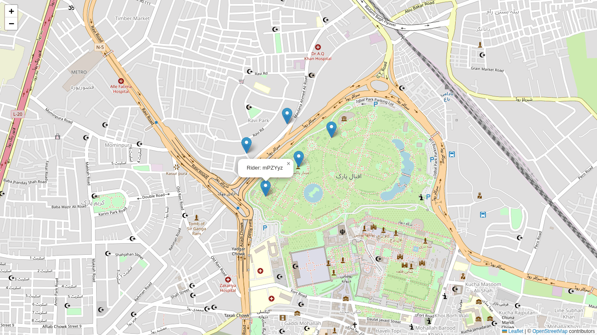
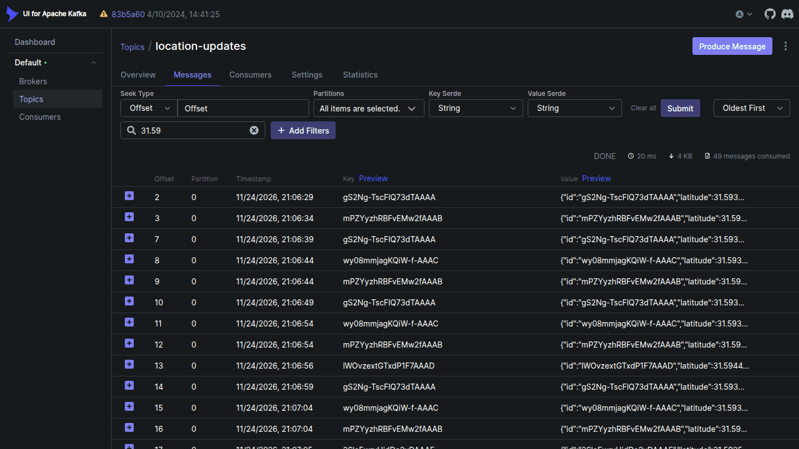
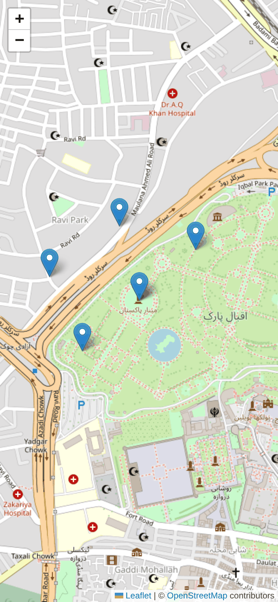
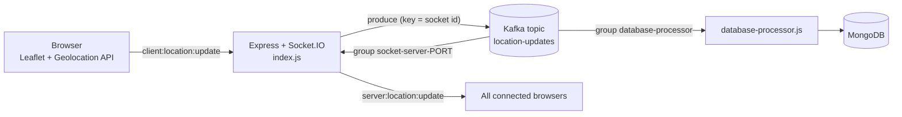

# 📍 Tracely

Real-time live location tracking on a map, built with **Socket.IO**, **Apache Kafka** and **MongoDB**.


Open Tracely in a browser, allow location access, and you appear on a shared map. Everyone else who has the page open shows up as a marker and moves in real time. Every location update travels through a Kafka topic, so the live map and the database are fed by independent consumers.

> Tracely is a learning / open-source project and is **not deployed**. All screenshots below are from a local run.

## Screenshots

**Live map**: four other riders and the viewer around Minar-e-Pakistan, Lahore. Clicking a marker shows the rider id.



**Kafka UI**: every location update is a message on the `location-updates` topic, keyed by the rider's socket id.



**Mobile browser**

<p align="center">
  
</p>

## Features

- Live map with one marker per connected rider (Leaflet + OpenStreetMap tiles)
- Your own position is sent every 10 seconds, and shown straight away on page load
- Markers move in real time and disappear when a rider disconnects
- Kafka sits between the socket server and everything else, so the map and the database are decoupled
- Locations are saved to MongoDB by a separate processor, so history is stored even if no one is watching the map
- Invalid coordinates are rejected before they reach Kafka
- `/health` endpoint for a quick status check

## How it works



1. The browser reads its position with the Geolocation API and emits `client:location:update` over Socket.IO.
2. The server validates the coordinates and publishes them to the Kafka topic `location-updates` (2 partitions, keyed by socket id so one rider's updates stay in order).
3. Two consumers read the topic independently:
   - the **socket server** broadcasts each update to all browsers, and
   - the **database processor** stores it in MongoDB.
4. When a socket disconnects, the server tells every browser to remove that rider's marker.

### Socket.IO events

| Event | Direction | Payload |
| --- | --- | --- |
| `client:location:update` | browser → server | `{ latitude, longitude }` |
| `server:location:update` | server → browsers | `{ id, latitude, longitude }` |
| `server:location:remove` | server → browsers | `id` (the rider that left) |

## Tech stack

| Part | Technology |
| --- | --- |
| Server | Node.js, Express 5, Socket.IO 4 |
| Messaging | Apache Kafka 4.2 (KRaft, single broker) via `kafkajs` |
| Database | MongoDB via Mongoose |
| Frontend | Plain HTML/CSS/JS, Leaflet 1.9, OpenStreetMap tiles |
| Tooling | pnpm, Docker Compose, Kafka UI |

## Getting started

### Prerequisites

- Node.js (developed and tested on v24)
- [pnpm](https://pnpm.io/)
- [Docker](https://www.docker.com/) with Docker Compose
- A MongoDB database, only needed for saving history (a free [MongoDB Atlas](https://www.mongodb.com/atlas) cluster works). The live map works without it.

### 1. Install and configure

```bash
git clone https://github.com/abdulrdeveloper/tracely.git
cd tracely
pnpm install
cp .env.example .env
```

Open `.env` and set `MONGO_URI` if you want to save locations.

### 2. Start Kafka

```bash
docker compose up -d
node kafka-admin.js      # creates the location-updates topic (2 partitions)
```

Kafka listens on `localhost:9092`, and Kafka UI is available at <http://localhost:8080>.

### 3. Run the app

```bash
pnpm dev                 # web + socket server on http://localhost:8000
pnpm dev:db              # optional: saves locations to MongoDB (needs MONGO_URI)
```

Open <http://localhost:8000> and allow location access.

### Trying it with more than one rider

Every browser tab is its own rider, so open the page in two or three windows. To fake different positions, use Chrome DevTools: **More tools → Sensors → Location**, then pick a city or enter coordinates. Each window sends its position within 10 seconds.

## Environment variables

| Variable | Default | Description |
| --- | --- | --- |
| `PORT` | `8000` | Port of the web and socket server |
| `NODE_ENV` | none | Shown in the startup log |
| `MONGO_URI` | none | MongoDB connection string, required only by `database-processor.js` |

## Scripts

| Command | What it does |
| --- | --- |
| `pnpm dev` | Starts the server with file watching |
| `pnpm dev:db` | Starts the database processor with file watching |
| `pnpm start` | Starts the server |
| `pnpm processor` | Starts the database processor |

## Project structure

```text
Tracely/
├── index.js                # Express + Socket.IO server, Kafka producer and consumer
├── database-processor.js   # Kafka consumer that saves locations to MongoDB
├── kafka-client.js         # Shared Kafka client config
├── kafka-admin.js          # Creates the location-updates topic
├── models/Location.js      # Mongoose schema
├── public/                 # Map UI (index.html, script.js, style.css)
├── docs/screenshots/       # Images used in this README
├── docker-compose.yml      # Kafka (KRaft) + Kafka UI
└── .env.example
```

## Known limitations

- No authentication: anyone who opens the page can see every connected rider's live position. Do not run it publicly with real users.
- Rider ids are Socket.IO ids, so a page refresh creates a new rider.
- A new visitor sees other riders after their next update (up to 10 seconds).
- Stored locations are never deleted.
- The Kafka broker address is fixed to `localhost:9092`.

## License

[MIT](LICENSE)
