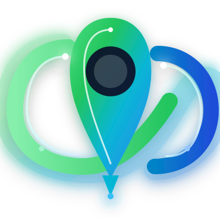
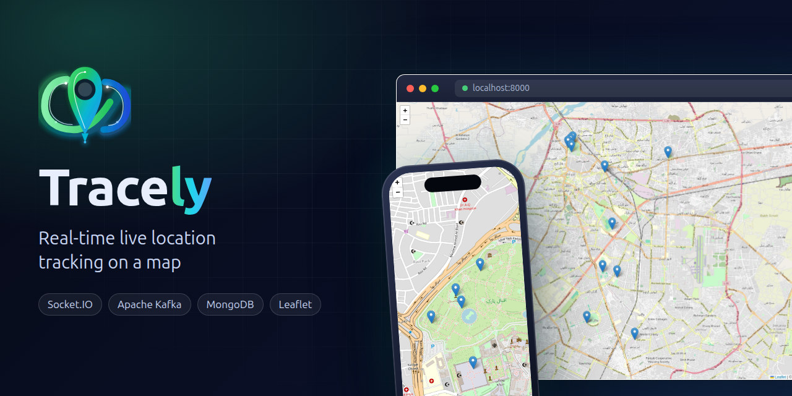
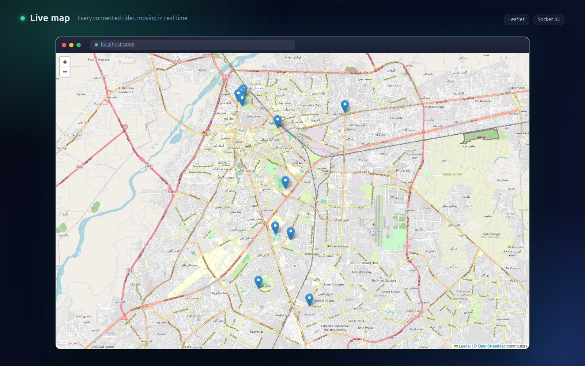
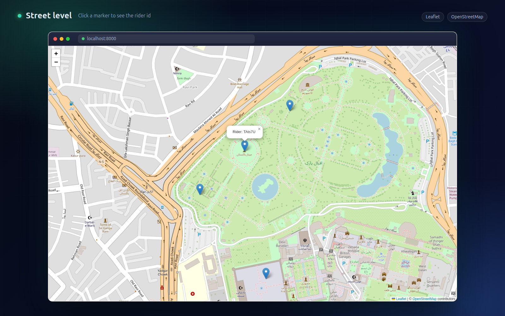
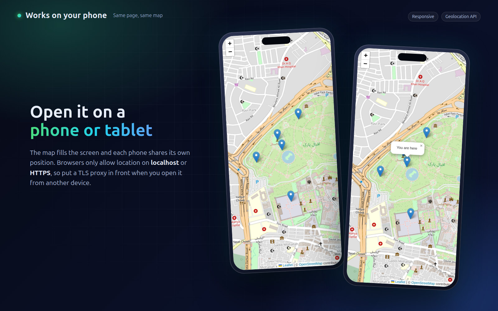
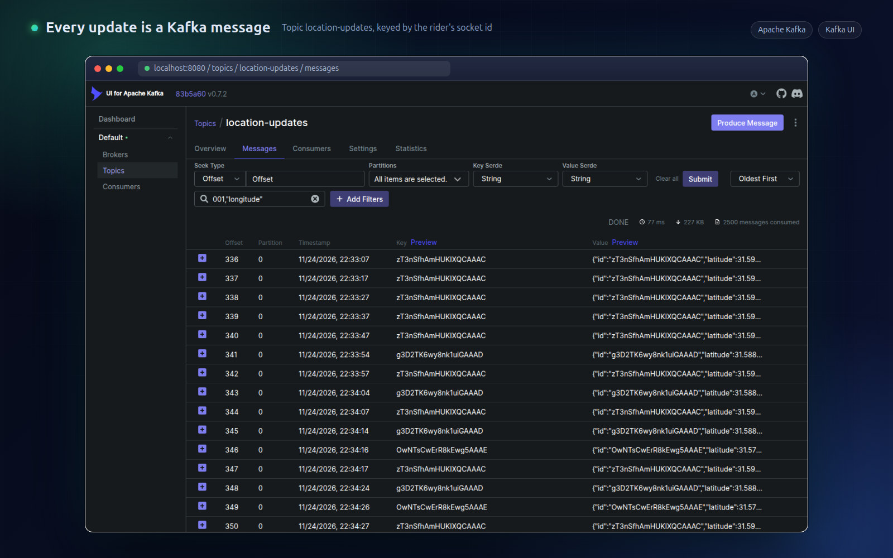
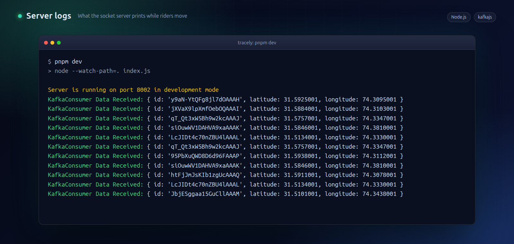
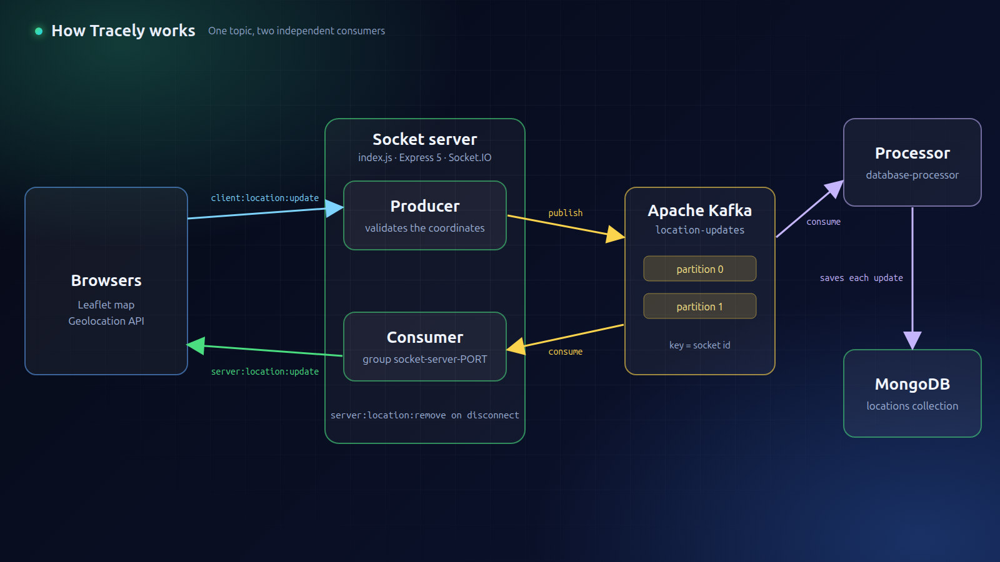

<p align="center">
  
</p>

<h3 align="center">Real-time live location tracking on a map, built on Socket.IO, Apache Kafka and MongoDB.</h3>

<p align="center">
  Open Tracely, allow location access, and you appear on a shared map. Everyone else who has the page open shows up as a marker and moves in real time. Every update travels through a Kafka topic, so the live map and the database are fed by independent consumers.
</p>

<p align="center">
  <a href="#run-it-yourself"><strong>Run it</strong></a>
  ·
  <a href="#screenshots">Screenshots</a>
  ·
  <a href="docs/ARCHITECTURE.md">Architecture</a>
  ·
  <a href="https://github.com/abdulrdeveloper/tracely/issues">Report a bug</a>
</p>

<p align="center">
  <a href="LICENSE"></a>
  
  
  
  
  
  <a href="CONTRIBUTING.md"></a>
</p>

<p align="center">
  
</p>

---

## What is Tracely?

Live location features (delivery tracking, ride sharing, "where is my friend")
all follow the same pattern: many devices send positions, many screens show
them, and you probably want to keep a history. Tracely is a small, readable
example of that pattern.

- **Browser:** plain HTML and JavaScript with Leaflet and OpenStreetMap tiles.
- **Server:** Node.js, Express 5 and Socket.IO.
- **Pipeline:** a Kafka topic between the socket server and everything else.
- **History:** a separate consumer that saves every update to MongoDB.

It is focused on one thing done clearly: positions in, markers out. Accounts,
rooms and routing are natural next steps, listed in the [Roadmap](#roadmap).

> Tracely is an open-source project that runs on your own machine in a few
> minutes. Everyone who opens your copy sees every rider, which is perfect for
> demos with friends and teammates. The images below come from a local run with
> ten fake riders placed around Lahore.

## Screenshots

### Live map

Every connected rider is a marker. Markers move as updates arrive and
disappear when a rider leaves.



### Street level

Click a marker to see the rider id.



### On a phone



### Kafka

Every update is a message on the `location-updates` topic, keyed by the
rider's socket id. This is [Kafka UI](https://github.com/provectus/kafka-ui),
included in the Docker Compose file.



### Server logs



## Features

### Live map
- One marker per connected rider, with the rider id in a popup.
- Your own marker says "You are here". The map centres on you and follows you
  as you move.
- Your position is sent as soon as the page loads, then every 10 seconds.
- A rider's marker is removed from every map when they disconnect.
- Works on phones and tablets (the map fills the screen).

### Kafka pipeline
- Updates are published to a Kafka topic with the socket id as the key, so
  each rider's updates stay in order.
- The socket server and the database processor are separate consumer groups,
  so either can be slow or stopped without affecting the other.
- Kafka and Kafka UI start with one `docker compose up -d`.

### Saved history
- `database-processor.js` writes every update to MongoDB with Mongoose.
- If MongoDB is down, Kafka redelivers the message instead of losing it.
- Bad data (invalid JSON or a validation error) is logged and skipped.

### Careful by default
- The server rejects coordinates that are not numbers or are outside the valid
  range before they reach Kafka.
- Errors from Kafka are logged and do not crash the server.
- `GET /health` for a quick status check.

## How it works



1. **Send:** the browser reads its position and emits `client:location:update`.
2. **Publish:** the server validates it and publishes it to the Kafka topic
   `location-updates`.
3. **Broadcast:** the server's own consumer reads the topic and emits
   `server:location:update` to every browser.
4. **Save:** the database processor reads the same topic and stores each update
   in MongoDB.
5. **Leave:** when a socket disconnects, the server emits
   `server:location:remove` and every browser removes that marker.

The full design, including Kafka settings and failure behaviour, is in
[docs/ARCHITECTURE.md](docs/ARCHITECTURE.md).

## Security first

Location is personal data, so Tracely is set up to keep it in your hands:

- **Your data stays with you.** Locations go to your own Kafka and your own
  MongoDB. There is no hosted service and no analytics.
- **Input is checked on the server.** Coordinates that are not numbers or are
  outside the valid range never reach Kafka.
- **Secrets stay out of git.** `.env` is ignored, and `.env.example` only has
  placeholders.
- **Share it on purpose.** Keep Kafka and Kafka UI on your machine or private
  network, and add sign-in before you share a copy more widely.

Details are in [SECURITY.md](SECURITY.md) and [PRIVACY.md](PRIVACY.md).

## Run it yourself

### You need

- **Node.js 24** and **pnpm 11** (`corepack enable` sets up pnpm)
- **Docker** with Docker Compose, for Kafka and Kafka UI
- A **MongoDB** database, only if you want to save history. A free
  [Atlas](https://www.mongodb.com/cloud/atlas/register) cluster or a local
  `mongodb://127.0.0.1:27017/tracely` works. The live map does not need it.

### Quick start

```bash
git clone https://github.com/abdulrdeveloper/tracely.git
cd tracely
pnpm install
cp .env.example .env

docker compose up -d      # Kafka on :9092 and Kafka UI on :8080
node kafka-admin.js       # creates the location-updates topic (2 partitions)
pnpm dev                  # map and socket server on http://localhost:8000
```

Open **http://localhost:8000** and allow location access.

To save history, set `MONGO_URI` in `.env` and run this in a second terminal:

```bash
pnpm dev:db
```

### Try it with more than one rider

Every browser tab is its own rider. Open the page in two or three windows. To
fake different places, use Chrome DevTools: **More tools → Sensors →
Location**. Each window shows up on the others within 10 seconds.

### Configuration

Set these in `.env` (see `.env.example`):

| Variable | Required | What it is |
| --- | --- | --- |
| `PORT` | No | Port of the web and socket server, default `8000` |
| `NODE_ENV` | No | Shown in the startup log |
| `MONGO_URI` | Only for `database-processor.js` | MongoDB connection string |

Never commit `.env` files.

### Make it yours

| What | Where |
| --- | --- |
| How often a position is sent (10 seconds) | `main()` in `public/script.js` |
| Default map view and tile source | Top of `public/script.js` |
| Geolocation accuracy and timeout | `getUsersCurrentLocation()` in `public/script.js` |
| Marker popups | `public/script.js` |
| Kafka address (`localhost:9092`) | `kafka-client.js` |
| Topic name and partition count | `kafka-admin.js`, plus the topic name in `index.js` and `database-processor.js` |
| Kafka and Kafka UI containers | `docker-compose.yml` |
| Saved fields | `models/Location.js` |

### Hosting your copy

Tracely runs anywhere Node.js and Kafka run. For a copy that other people use,
plan for:

- A host that keeps long-lived connections open. Serverless functions do not
  fit Socket.IO and a Kafka consumer.
- HTTPS, because browsers only share location on `localhost` or HTTPS.
- A Kafka broker the server can reach, with its address set in
  `kafka-client.js`.
- Sign-in in front of the page, so riders only see the people they should.
- Kafka and Kafka UI on a private network. The provided Compose file is made
  for local development, and Kafka UI has no login.

Read [SECURITY.md](SECURITY.md) and [PRIVACY.md](PRIVACY.md) before you invite
other people.

## Socket.IO events and HTTP

| Event | Direction | Payload |
| --- | --- | --- |
| `client:location:update` | browser → server | `{ latitude, longitude }` |
| `server:location:update` | server → browsers | `{ id, latitude, longitude }` |
| `server:location:remove` | server → browsers | `id` of the rider that left |

| Method | Route | What it does |
| --- | --- | --- |
| `GET` | `/health` | Returns `{ "healthy": true, ... }` for status checks |
| `GET` | `/` | Serves the map from `public/` |

## Tech stack

| Area | Tools |
| --- | --- |
| Server | Node.js, Express 5, Socket.IO 4 |
| Messaging | Apache Kafka 4.2 (KRaft, single broker) with `kafkajs` |
| Database | MongoDB with Mongoose |
| Frontend | HTML, CSS and JavaScript, Leaflet 1.9, OpenStreetMap tiles |
| Tooling | pnpm, Docker Compose, Kafka UI |

## Useful commands

| Command | What it does |
| --- | --- |
| `pnpm dev` | Start the server and restart it when files change |
| `pnpm dev:db` | Start the database processor with file watching |
| `pnpm start` | Start the server |
| `pnpm processor` | Start the database processor |
| `node kafka-admin.js` | Create the `location-updates` topic |
| `docker compose up -d` / `down` | Start or stop Kafka and Kafka UI |

## Project layout

```text
index.js                 Express + Socket.IO server, Kafka producer and consumer
database-processor.js    Kafka consumer that saves updates to MongoDB
kafka-client.js          Shared Kafka client config
kafka-admin.js           Creates the location-updates topic
models/Location.js       Mongoose schema
public/                  Map UI: index.html, script.js, style.css, logo
docs/                    Architecture notes and README images
docker-compose.yml       Kafka (KRaft) and Kafka UI
```

## Project status

Tracely works end to end: browser, Socket.IO, Kafka, MongoDB and back to every
other browser. It was run locally with ten riders at once.

### Good to know

- Run `node kafka-admin.js` before the server so the topic gets 2 partitions.
  Otherwise Kafka creates it with 1.
- A rider appears on a new visitor's map after their next update, which is
  within 10 seconds.
- After a restart, the server catches up from its last Kafka offset, so riders
  can briefly show at their previous positions.
- If Kafka's group coordinator is briefly unavailable, the server logs
  `KafkaConsumer crashed` and exits. Start it again.
- Saved locations stay in MongoDB until you delete them.
- A rider's id is its socket id, so a refresh starts a new rider and
  the old marker is removed.

## Roadmap

Good places to start contributing:

- **Sign-in and rooms**, so riders only see the people they choose.
- **Rate limiting** for location updates.
- **Configuration from `.env`** for the Kafka address and topic name.
- **Stable rider ids**, so a refresh keeps the same rider.
- **Instant first view**, sending the current riders to a new visitor on
  connect.
- **Automatic cleanup** of old saved locations, for example with a MongoDB TTL
  index.
- **Several server instances**, with sticky sessions and removal events
  through Kafka.
- **Automated tests.**

## Contributing

Contributions are welcome, from typo fixes to new features. Please read
[CONTRIBUTING.md](CONTRIBUTING.md) and follow our
[Code of Conduct](CODE_OF_CONDUCT.md). Every change goes through a pull request.

Need help? See [SUPPORT.md](SUPPORT.md). Changes are listed in
[CHANGELOG.md](CHANGELOG.md).

## Security

Found a vulnerability? Please report it privately as described in
[SECURITY.md](SECURITY.md) instead of opening a public issue.

## Policies

- [Privacy Policy](PRIVACY.md)

## License

Released under the [MIT License](LICENSE). Copyright (c) 2026 Abdul Rahman.
