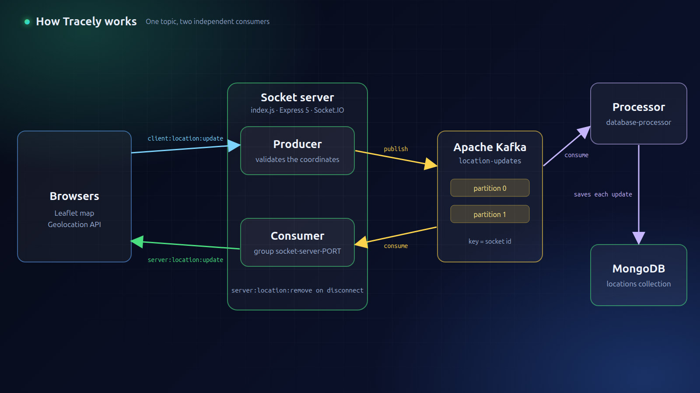

# Architecture

This page explains how Tracely moves a location from one browser to every
other browser, and why Kafka sits in the middle.

## Components

| Component | File | Job |
| --- | --- | --- |
| Browser client | `public/script.js` | Reads the position, sends it, draws markers |
| Socket server | `index.js` | Validates updates, publishes to Kafka, broadcasts what Kafka delivers |
| Kafka topic | `location-updates` | The single source of truth for location updates |
| Database processor | `database-processor.js` | Independent consumer that saves updates to MongoDB |
| Kafka setup | `kafka-client.js`, `kafka-admin.js` | Shared client config and topic creation |
| Model | `models/Location.js` | Mongoose schema for saved locations |

## Life of one location update

1. `public/script.js` calls `navigator.geolocation.getCurrentPosition` once on
   page load and then every 10 seconds, and emits
   `client:location:update` with `{ latitude, longitude }`.
2. The server checks that both values are finite numbers inside the valid
   ranges (latitude -90 to 90, longitude -180 to 180). Anything else is
   dropped.
3. The server publishes `{ id, latitude, longitude }` to the Kafka topic
   `location-updates`. The message key is the Socket.IO id of the sender.
4. Kafka delivers the message to **every consumer group** subscribed to the
   topic:
   - `socket-server-<PORT>`: the server's own consumer. It emits
     `server:location:update` to all connected browsers.
   - `database-processor`: saves the update to MongoDB.
5. Each browser ignores updates with its own id, and creates or moves the
   marker of the sender.
6. When a Socket.IO connection closes, the server emits
   `server:location:remove` with that rider's id and every browser removes the
   marker.

The sender never draws its own marker from the broadcast. It draws it directly
from the position the browser just read.

## Why Kafka

A simpler version would broadcast straight from the socket handler. Putting a
topic in between gives you:

- **Decoupling.** The map and the database read the same stream
  independently. The processor can be stopped, slow or restarted without
  affecting the live map, and it catches up from where it left off.
- **Fan-out.** Adding another consumer (analytics, alerts, a second map
  server) means adding a consumer group. The producer does not change.
- **Ordering per rider.** The key is the socket id, so all updates from one
  rider go to the same partition and stay in order.
- **Replay.** A new consumer group with `fromBeginning: true` can read
  everything Kafka still retains.

The cost is running Kafka. For a single machine and a few riders, a direct
broadcast would be simpler. Tracely uses Kafka on purpose, to show the pattern.

## Kafka layout

| Setting | Value |
| --- | --- |
| Topic | `location-updates` |
| Partitions | 2 when created by `node kafka-admin.js` (Kafka creates 1 if the topic is auto-created on first use) |
| Message key | Socket.IO id of the sender |
| Message value | JSON: `{ "id": "...", "latitude": 0, "longitude": 0 }` |
| Broker | Single node in KRaft mode, `localhost:9092` (fixed in `kafka-client.js`) |

Consumer groups:

| Group | Reads from | Why |
| --- | --- | --- |
| `socket-server-<PORT>` | The end of the topic (`fromBeginning: false`) | Live map only. The group id contains the port, so each server instance gets its own copy of every message and can broadcast to its own browsers |
| `database-processor` | The beginning (`fromBeginning: true`) | A new processor saves all retained history |

## Saved data

`database-processor.js` creates one document per update with Mongoose:

| Field | Type | Notes |
| --- | --- | --- |
| `userId` | String | The rider id (socket id). Indexed |
| `latitude` | Number | |
| `longitude` | Number | |
| `timestamp` | Date | Time the processor saved the record |
| `createdAt`, `updatedAt` | Date | Added by Mongoose `timestamps` |

If saving fails because the data is bad (invalid JSON or a validation error),
the message is logged and skipped. Any other error, such as MongoDB being
down, is rethrown so Kafka redelivers the message instead of losing it. This
means a record can be saved twice after a retry.

## Failure behaviour

| Situation | What happens |
| --- | --- |
| Kafka is down at startup | The server cannot start and exits with the connection error |
| Kafka send fails for one update | The error is logged and that update is lost. The socket stays connected |
| A message on the topic is not valid JSON | The socket server skips it |
| MongoDB is down | The processor retries the message. The live map is not affected |
| Kafka's group coordinator is briefly unavailable | The socket server's consumer can crash and the map stops updating until the server is restarted |
| Server restarts | It resumes from the last committed offset of its group and replays what it missed while it was down |

## Scaling notes

Tracely is built to run as a single server. Things to know if you try more:

- **Several server instances** work with Kafka because each has its own
  consumer group, but `server:location:remove` is emitted locally, so a
  disconnect is only announced to the browsers of the server that owned the
  socket. Socket.IO would also need sticky sessions behind a load balancer.
- **More database processors** can share the `database-processor` group. Kafka
  splits partitions between them, so the topic needs more than one partition.
- **There is no authentication, rate limiting or per-room separation.** All
  riders share one map. See [SECURITY.md](../SECURITY.md).

## Ports

| Port | Service |
| --- | --- |
| 8000 | Tracely web and socket server (`PORT` to change) |
| 9092 | Kafka |
| 8080 | Kafka UI (no login) |
